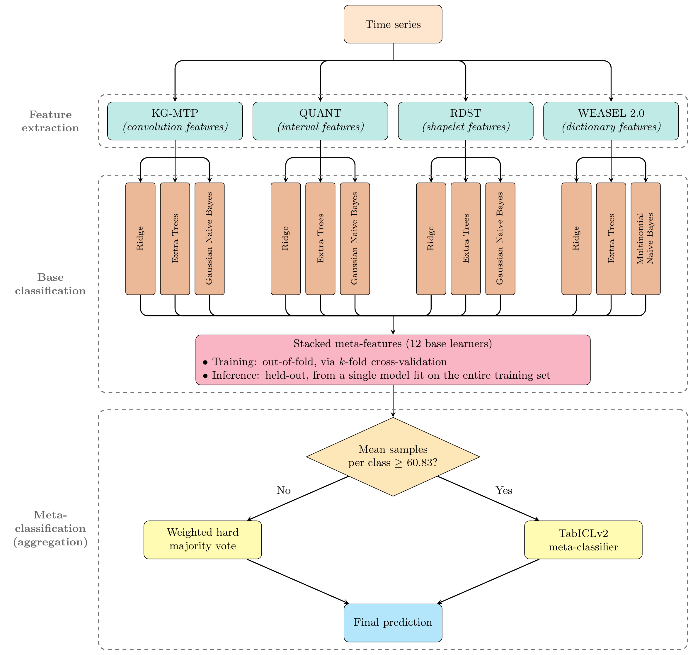

# TIGER: Time-Series Classification with In-Context-Learning Gated Ensemble of Representations

This repository accompanies the following paper:

> Johann Faouzi. *TIGER: Time-Series Classification with In-Context-Learning Gated Ensemble of Representations*. 2026. https://arxiv.org/abs/2610.06156


## Presentation

The figure below summarizes the architecture of TIGER:

<p align="center">
  <a href="tiger_architecture.png">
    
  </a>
</p>

Ensemble algorithms that combine several representation families remain the most accurate approach to time series classification.
A representation family is a distinct way of extracting predictive features from a time series, such as a convolution-, interval-, shapelet-, or dictionary-based transformation.
Current state-of-the-art ensembles, most notably HIVE-COTE 2.0, pair a bespoke classification algorithm with each representation family and combine their predictions using a fixed, non-adaptive rule.

TIGER instead applies the same small portfolio of three general-purpose classifiers (Ridge, Extra Trees, and Naive Bayes) to four representation families (convolution, interval, shapelet, and dictionary), and combines them as follows:
* Each of the 4 families x 3 classifiers pair is fit as a base learner, producing 12 sets of out-of-fold predictions.
* These 12 base learners' out-of-fold predictions are stacked into a single meta-feature matrix.
* A final prediction is produced by an adaptive meta-classification rule that chooses, independently for each data set, between a weighted hard majority vote and TabICLv2, a pretrained tabular foundation model used in-context as a meta-classifier, based on the mean number of training samples available per class.

On a 142-data-set benchmark drawn from the UCR time series classification archive, TIGER obtains the best mean accuracy, balanced accuracy, and F1-score among six compared algorithms, including HIVE-COTE 2.0, and significantly outperforms each of the other five individually.
TIGER's adaptive rule also meaningfully outperforms either of its two constituent meta-classification methods used alone, and its single hyperparameter, tuned using only a twenty-data-set development subset, is shown to generalize to the full evaluation benchmark.


## Layout

```
src/tsfm_ensemble/            TIGER's core package
  families.py                 per-family feature extractors (convolution, interval, shapelet, dictionary)
  quant.py                    this project's own implementation of the QUANT transformation step
  kg_mtp.py                   this project's own implementation of the KG-MTP transformation step
  base_learners.py            the 12 (family, classifier) base learners and their out-of-fold scoring
  meta_learners.py            the candidate meta-classification methods (incl. weighted hard majority vote)
  backbone.py                 TabICLv2 wrapper (column-grouping + ECOC option)
  meta_learner_selection.py   TIGER's deployed adaptive rule (chooses WHMV vs. TabICLv2)
  timing.py                   shared runtime-measurement helpers
  utils.py                    small shared helpers
src/experiments/              runs experiments and caches raw results under results/
src/analyses/                 reads already-computed results/ manifests and produces the tables and figures
comparisons/                  published results for literature algorithms, used as comparison baselines
PythonResampleIndices/        train/test resample indices for every UCR data set
results/                      cached experiment outputs
```


## Dependencies

All the experiments were run on a machine with Python 3.13.5 and the following dependencies:
* aeon==1.6.0
* lightgbm==4.7.0
* matplotlib==3.11.2
* numba==0.63.1
* numpy==2.3.5
* pandas==2.3.3
* scikit-learn==1.7.2
* scipy==1.17.1
* tabicl==2.2.0
* tabpfn-extensions==0.6.2
* torch==2.14.0

These dependencies are listed in the `requirements.txt` file and can be installed using `pip install -r requirements.txt`.
Using a virtual environment to run the experiments is strongly advised.

TabICLv2 (via the `tabicl` package) requires network access to Hugging Face Hub on first use, to download its pretrained checkpoint.


## Experiments

To reproduce all the experiments, run the following scripts from the root of this repository, in the order given below. Every script under `src/experiments/` caches its raw output under `results/`; every script under `src/analyses/` only reads those already-computed results and writes the paper's actual tables and figures to `results/paper/`.

### 1. Development-subset pipeline (derives the adaptive rule's threshold)

* `python -m src.experiments.save_dev_subset_transforms`: saves every family's raw, pre-reduction transform output for the twenty-data-set development subset.
* `python -m src.experiments.build_stacking_features`: builds and caches the 12 base learners' out-of-fold and test scores for the development subset.
* `python -m src.experiments.build_meta_model_predictions`: builds and caches every candidate meta-method's predictions for the development subset.
* `python -m src.experiments.analyze_meta_learner_selection`: scans every candidate samples-per-class threshold and derives TIGER's deployed adaptive rule (`tsfm_ensemble.meta_learner_selection`).
* `python -m src.experiments.compute_resample_train_coverage`: computes the development subset's per-dataset training-sample coverage, cited in Table 2.

### 2. Full 142-data-set benchmark: TIGER

* `python -m src.experiments.save_142_transforms`: saves every family's raw transform output across the full 142-data-set, 30-resample benchmark.
* `python -m src.experiments.cv_ablation_142`, `python -m src.experiments.analyze_cv_ablation_142`, `python -m src.experiments.analyze_cv_ablation_runtime_142`: the out-of-fold estimator ablation (cross-validation vs. bagging-OOB vs. native-OOB) for the 12 base learners.
* `python -m src.experiments.build_meta_model_predictions_142`: builds and caches every candidate meta-method's predictions across the full benchmark.
* `python -m src.experiments.apply_meta_learner_selection_142`: applies the dev-subset-derived adaptive rule to the full benchmark, adding TIGER's deployed `auto_selected` predictions.
* `python -m src.experiments.compute_auto_selected_metrics_142`: computes balanced accuracy, log loss, AUROC, and F1-score for TIGER's deployed predictions.

### 3. Full 142-data-set benchmark: baselines

* `python -m src.experiments.run_142_hc2`: runs HIVE-COTE 2.0 (via aeon) across the full benchmark.
* `python -m src.experiments.run_142_original_algorithms`: runs the four other literature algorithms (RDST, QUANT, WEASEL 2.0, KG-MTP) across the full benchmark.
* `python -m src.experiments.compare_tabiclv2_multiclass_handling`: compares TabICLv2's native many-class handling against its ECOC-wrapped variant.

### 4. Runtime measurements

* `python -m src.experiments.measure_base_learner_final_split_142`, `python -m src.experiments.measure_meta_classification_split_142`, `python -m src.experiments.compute_train_inference_split_142`: together split TIGER's own training/inference timings into the pieces its deployed pipeline doesn't time separately.
* `python -m src.experiments.compute_runtime_tables_142`: combines those timings with the baselines' own (from steps 2 and 3 above) and prints the paper's runtime tables to the console.

### 5. Tables and figures

Every script below is in `src/analyses/`, reads only already-computed results from the steps above, and writes its output to `results/paper/tables/` or `results/paper/figures/`:

* `table_meta_method_comparison`: every candidate meta-method's accuracy and mean rank on the full benchmark.
* `table_auto_selected_holdout`: held-out validation of the deployed adaptive rule.
* `figure_auto_selected_threshold`: the adaptive rule's threshold mechanism and held-out result.
* `figure_critical_difference`: critical-difference diagram across every candidate meta-method.
* `table_multi_metric`: TIGER vs. the five literature algorithms, on accuracy, balanced accuracy, AUROC, log loss, and F1-score.
* `table_literature_comparison`: TIGER vs. the five literature algorithms, win/loss/tie counts and significance tests.
* `figure_critical_difference_literature`: critical-difference diagram for the six-algorithm comparison.
* `table_oof_estimator_ablation`, `table_oracle_headroom`, `table_oracle_headroom_by_characteristics`, `table_family_standalone_strength`, `figure_ridge_calibration`, `table_multiclass_handling`: the ablation-experiment tables and figures.
* `table_discarded_design_wide_selection`, `figure_discarded_design_feature_counts`, `figure_discarded_design_comparison_with_originals`: results for the discarded design alternatives discussed in the paper.

A few other scripts under `src/experiments/` (`check_dataset_loading.py`, `profile_tabiclv2_memory.py`, `resample_stability.py`, `analyze_family_strengths.py`) are development-time diagnostic utilities and are not required to reproduce any number reported in the paper.


## Credits

The files in the `comparisons/bake-off-redux-2023` directory and the `PythonResampleIndices` directory have been taken from other repositories.
They have been copied into this repository to make sure that this repository is standalone, in case that the files would not be available anymore for whatever reason.
All the credits for these files should go to the corresponding authors: [Matthew Middlehurst](https://github.com/MatthewMiddlehurst), [Patrick Schäfer](https://github.com/patrickzib), and [Anthony Bagnall](https://github.com/TonyBagnall), who produced them for [Bake off redux: a review and experimental evaluation of recent time series classification algorithms](https://link.springer.com/article/10.1007/s10618-024-01022-1).

The files in the `comparisons/KG-MTP` directory were produced by running the original authors' own published implementation of KG-MTP ourselves.
The credits for the KG-MTP algorithm should go to Panjie Wang, Jiang Wu, Yuan Wei, and Taiyong Li, who introduced it in [Kernel grouping for time series classification with multiple transformations and pooling operators](https://doi.org/10.1016/j.eswa.2025.128693).


## Citation

If you use TIGER in a scientific publication, the following citation in your publication would be appreciated:

> Johann Faouzi. *TIGER: Time-Series Classification with In-Context-Learning Gated Ensemble of Representations*. 2026. https://arxiv.org/abs/2610.06156

This citation will be updated when the paper is published in a peer-reviewed journal or conference.
